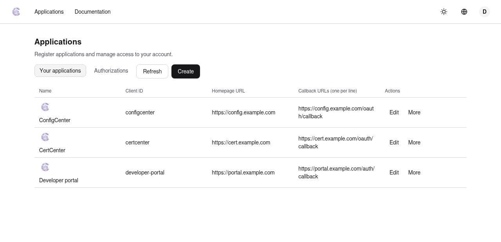

<p align="center">
  
</p>
<h3 align="center">AuthCenter</h3>
<p align="center">A self-hosted OAuth authorization service with application management and two-step account authentication.</p>

<p align="center">
  <a href="README.md">English</a> · <a href="README_zh.md">简体中文</a>
</p>

<p align="center">
  <a href="docs/index.md">Documentation</a> · <a href="#quick-start">Deployment</a> · <a href="docs/configuration.md">Configuration</a> · <a href="docs/security.md">Security</a>
</p>

<p align="center">
  <a href="https://github.com/OXeu/authcenter/actions/workflows/ci.yml"></a>
  <a href="go.mod"></a>
  <a href="package.json"></a>
  <a href="LICENSE"></a>
</p>

## Preview



Application management in the actual web UI, rendered with synthetic example data.

## Features

- OAuth authorization codes, S256 PKCE, consent, user information and token rotation/revocation.
- GitHub sign-in or password authentication with TOTP/email verification.
- Registered applications with multiple callback URLs, client types and uploaded logos.
- ConfigCenter-backed runtime configuration, SQLite/MySQL and an English/Chinese UI.

## Quick Start

Install Git, Make, Node.js 24.15+ with npm, and Go 1.26.10, with Git access to the pinned center-common repository. A running ConfigCenter is required: create a dedicated project, its `production` environment and a key with configuration-read permission.

1. In that project, set `AC_LOCAL_LOGIN=false` for a minimal GitHub-only setup.
2. Configure `AC_OAUTH_CLIENT_ID`, `AC_OAUTH_CLIENT_SECRET` and the intended `AC_BOOTSTRAP_ADMIN_EMAIL`.
3. Register `http://127.0.0.1:8081/oauth/callback` at GitHub.
4. Replace the connection URL and API key below with your own values.

```sh
git clone https://github.com/OXeu/authcenter.git
cd authcenter
make bootstrap
make build
AC_CONFIGCENTER_URL=http://127.0.0.1:8080 \
AC_CONFIGCENTER_API_KEY=cc_replace_with_your_read_key \
AC_CONFIGCENTER_ENVIRONMENT=production \
./.tmp/bin/authcenter
```

Open http://127.0.0.1:8081. The default application database is `.tmp/authcenter.db`. Only the `AC_CONFIGCENTER_*` bootstrap values belong in the local environment; runtime settings live in ConfigCenter.

### Password login and production

Password registration needs `AC_LOCAL_LOGIN=true`, a persisted 32-byte Base64 `AC_ENCRYPTION_KEY`, and Resend mail configuration in ConfigCenter. Production uses an HTTPS public address and a shared database. See [deployment](docs/deployment.md), [configuration](docs/configuration.md) and [security](docs/security.md) before enabling it. Run `make check` with golangci-lint installed to validate changes.

## Star History

[](https://www.star-history.com/#OXeu/authcenter&Date)

## LICENSE

Licensed under the [Apache License 2.0](LICENSE).
