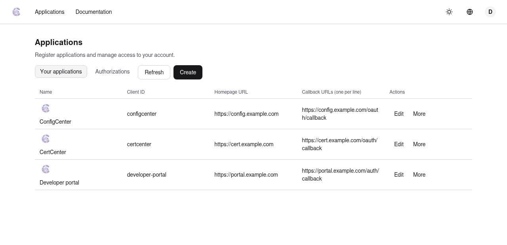

<p align="center">
  
</p>
<h3 align="center">AuthCenter</h3>
<p align="center">提供应用管理与两步身份验证的自托管 OAuth 授权中心。</p>

<p align="center">
  <a href="README.md">English</a> · <a href="README_zh.md">简体中文</a>
</p>

<p align="center">
  <a href="docs/index.md">使用文档</a> · <a href="#快速开始">部署</a> · <a href="docs/configuration.md">环境与配置</a> · <a href="docs/security.md">安全行为</a>
</p>

<p align="center">
  <a href="https://github.com/OXeu/authcenter/actions/workflows/ci.yml"></a>
  <a href="go.mod"></a>
  <a href="package.json"></a>
  <a href="LICENSE"></a>
</p>

## 预览



应用管理界面，使用实际前端与示例数据渲染。

## 功能

- OAuth 授权码、S256 PKCE、用户同意、用户信息及令牌轮换与撤销。
- GitHub 登录，或密码配合 TOTP / 邮箱验证码。
- 应用注册、多个回调地址、客户端类型与 Logo 上传。
- 从 ConfigCenter 读取运行配置，支持 SQLite / MySQL 与中英文界面。

## 快速开始

需要 Git、Make、带 npm 的 Node.js 24.15+、Go 1.26.10，以及锁定的 center-common 仓库的读取权限。先部署 ConfigCenter，创建独立项目、`production` 环境和具有配置读取权限的密钥。

1. 在该项目中设置 `AC_LOCAL_LOGIN=false`，使用最小的 GitHub 登录配置。
2. 填写 `AC_OAUTH_CLIENT_ID`、`AC_OAUTH_CLIENT_SECRET` 和目标管理员的 `AC_BOOTSTRAP_ADMIN_EMAIL`。
3. 在 GitHub 登记回调地址 `http://127.0.0.1:8081/oauth/callback`。
4. 将以下地址和密钥替换为实际连接信息。

```sh
git clone https://github.com/OXeu/authcenter.git
cd authcenter
make bootstrap
make build
AC_CONFIGCENTER_URL=http://127.0.0.1:8080 \
AC_CONFIGCENTER_API_KEY=cc_replace_with_your_read_key \
AC_CONFIGCENTER_ENVIRONMENT=production \
./.tmp/bin/authcenter
```

打开 http://127.0.0.1:8081。默认应用数据库位于 `.tmp/authcenter.db`。本地环境只提供 `AC_CONFIGCENTER_*` 引导参数，业务运行参数在 ConfigCenter 中配置。

### 密码登录与生产环境

密码注册需要在 ConfigCenter 中配置 `AC_LOCAL_LOGIN=true`、持久保存的 32 字节 Base64 `AC_ENCRYPTION_KEY`，以及 Resend 邮件参数。生产使用 HTTPS 公网地址与共享数据库；启用前阅读[配置文档](docs/configuration.md)和[安全说明](docs/security.md)。安装 golangci-lint 后可运行 `make check` 验证改动。

## Star History

[](https://www.star-history.com/#OXeu/authcenter&Date)

## LICENSE

本项目采用 [Apache License 2.0](LICENSE) 开源协议。
